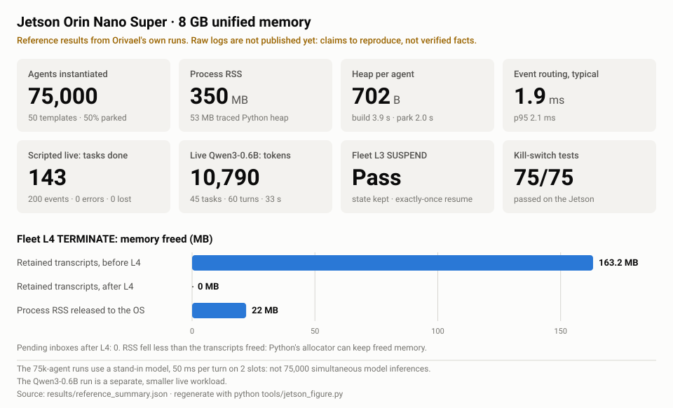

# AxLab

**Reproduce the research. Challenge the benchmarks. Bring your own hardware.**

AxLab is the public experiment lab for Orivael's AXIOM agent infrastructure.
Each research track is an experiment you can run on your own machine, with
the code it measures, its raw results, and the limits of what it shows.

> **Status: v0.1 pre-release.** Three tracks run from this repo today: Slim
> Agent Fabric, Fleet Kill Switch and Bounded Failure Under Agent Escalation. The 75k-agent Jetson and Android
> numbers below are reference results from Orivael's own runs. Their raw
> logs are not published yet, so treat them as claims to reproduce, not as
> verified facts. See [docs/RELEASE_CHECKLIST.md](docs/RELEASE_CHECKLIST.md).

## Quickstart

You need Python 3.11+. There is no model download, no API key and no paid
service.

```bash
git clone https://github.com/Orivael-Dev/axlab && cd axlab
python -m venv .venv && . .venv/bin/activate      # Windows: .venv\Scripts\activate
pip install -e ".[test]"
pytest                                             # 85 tests, ~10 seconds

# 1,000 agents with a scripted model (no model calls, no network)
python experiments/slim_fabric/bench.py --agents 1000 --templates 10 --live 50 --backend fake
```

Then scale up (`--agents 10000`, `--agents 75000`), or point it at a model
served by a local [Ollama](https://ollama.com):

```bash
python experiments/slim_fabric/bench.py --agents 75000 --live 40 \
    --backend ollama --model qwen3:0.6b --slots 2 --out results/local/my-run.json
```

Check the model tag on your own system; the one above is an example. Nothing
leaves your machine unless you choose `--backend ollama`, and even then it
only talks to the Ollama URL you give it (default `http://localhost:11434`).

## Research tracks

| Track | Question | Runs here? |
|---|---|---|
| [Slim Agent Fabric](experiments/slim_fabric/) | How many live agents fit in a small memory budget, and what does routing an event cost? | Yes |
| [Fleet Kill Switch](experiments/fleet_kill_switch/) | What does an L1–L4 stop cost, how fast does it reach every agent, and how many tokens does it save? | Yes, except `runnode` (needs the AXIOM loop runner) |
| [Bounded Failure Under Agent Escalation](experiments/bounded_failure/) | When 1,000 agents fail, loop, get prompt-injected or probe permissions, does each failure stay inside its boundaries: no unauthorized side effects, no retries past the ceiling, no budget overruns, no spread to healthy agents? | Yes |
| AXIOM Pocket (Android) | Local inference on a phone: load time, decode speed, heat | Not yet: reference numbers only |

To add a new track, see [docs/ADDING_RESEARCH.md](docs/ADDING_RESEARCH.md).

## MCP server

`python -m axlab.mcp` gives an agent a kill switch it can pull but not
release (L1 warn … L4 terminate, with a reason, written to a receipt log),
and runs the benchmarks above on request. Lowering the switch stays a signed
human step on the command line. It uses only the standard library, and this
repo's `.mcp.json` registers it for Claude Code. See [docs/MCP.md](docs/MCP.md).

## What's in the repo

```text
axlab/                  audited code the experiments measure
  fabric/               slim agent fabric: pool, board, store, runtime, backends
  governance/           fleet kill switch (stdlib only)
  mcp/                  MCP server: kill switch + benchmarks (python -m axlab.mcp)
  signing.py            per-module HMAC key derivation
experiments/<track>/    one folder per research track: bench, README, results, figures
results/                reference summaries; your own runs go in results/local/ (git-ignored)
tests/                  unit tests for everything under axlab/
docs/                   protocol, checklist, provenance, how to add research
```

The code under `axlab/` was exported from a specific AXIOM commit. Only
imports were changed, plus a few cuts. [docs/PROVENANCE.md](docs/PROVENANCE.md)
lists every file and every change.

## Reference results (from Orivael, not yet independently reproduced)



| Experiment | Hardware | Observed | Important boundary |
|---|---|---|---|
| Slim Fabric | Jetson Orin Nano Super | 75,000 instantiated agents, 50 templates, half parked; ~350 MB process RSS; 53 MB Python traced heap | Stand-in model for the full-fleet workload; **not** 75k simultaneous model inferences |
| Fleet L4 | Jetson Orin Nano Super | Retained transcripts 163.2 MB → 0 MB; pending inboxes emptied | Process RSS dropped only ~22 MB; Python's allocator may keep freed memory |
| Fleet L3 | Jetson Orin Nano Super | State retained; exactly-once resume checks passed | Suspended-while-waiting-on-a-tool cases should be added |
| Live local Qwen | Jetson Orin Nano Super | Qwen3-0.6B, 40 events, 45 tasks, 60 turns, 10,790 tokens, 33 s | Separate, smaller live workload |
| Pocket APK inference | Samsung SM-F936U, Android 16 | 147 turns; 0.89 s model load, 41.3 output tok/s, 1.08 s median turn | Phone inference only; no 75k-agent phone benchmark |

The machine-readable version is [results/reference_summary.json](results/reference_summary.json).
Its internal consistency is checked by `python tools/check_reference_results.py`.
That check catches typos, not wrong measurements.

The Fleet Kill Switch track publishes its raw results in
[experiments/fleet_kill_switch/results/](experiments/fleet_kill_switch/results/),
from one Windows desktop run.

## Design principles

- Label every number: measured, simulated model, or projected capacity.
- Report the host: hardware, OS / Android version, Python, model ID and
  quantization, context, slots, seed, repetitions, peak RSS, task
  correctness and stop behavior.
- Zero external API charges is not zero operating cost.
- Clearing logical state is not the same as the OS reclaiming RSS.
- Failures, missing measurements and flaky tests stay visible.

## Contribute a run

Open a [hardware benchmark report](.github/ISSUE_TEMPLATE/benchmark-report.md)
with the raw JSON, the exact commit hash, your model/backend version and any
correctness failures. The protocol is in
[docs/EXPERIMENT_PROTOCOL.md](docs/EXPERIMENT_PROTOCOL.md).

## License

[PolyForm Noncommercial 1.0.0](LICENSE). You may use, study, modify and share
AxLab for any **noncommercial** purpose: personal research, study, hobby
projects, and use by charities, schools, universities, public research
organizations and government bodies. Commercial use needs a separate license:
contact **hello@orivael.dev**. Copies must keep the [NOTICE](NOTICE) line.

This is a source-available license, not an OSI-approved open-source license.

**Contact:** hello@orivael.dev · **Research notes:** https://research.orivael.dev
